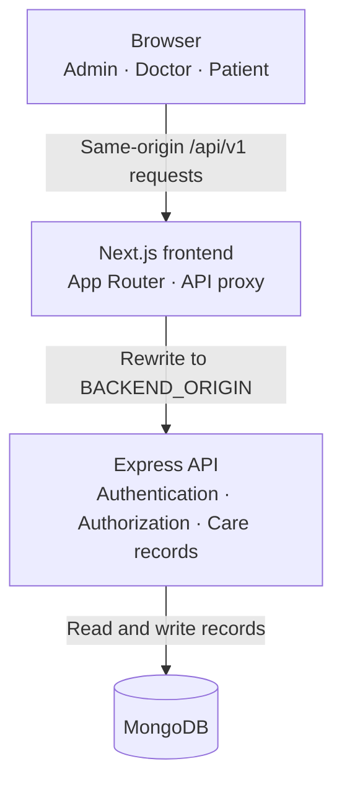
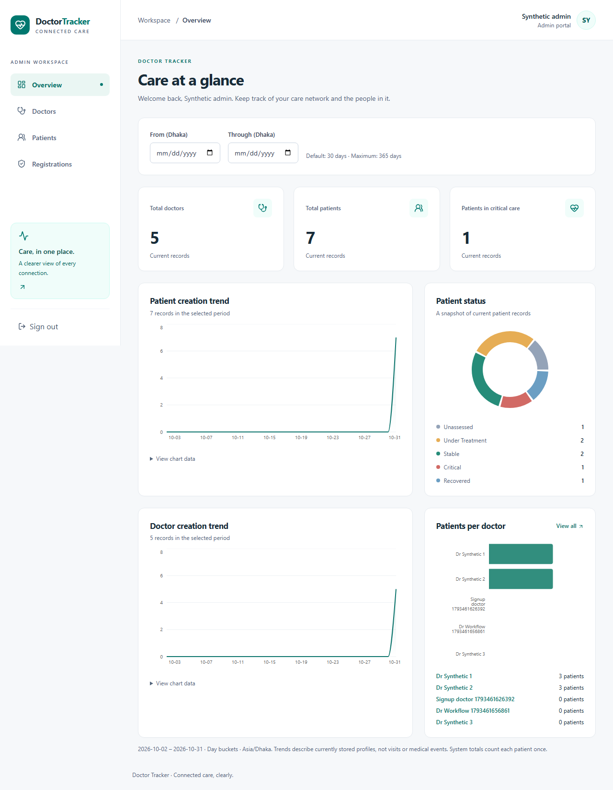
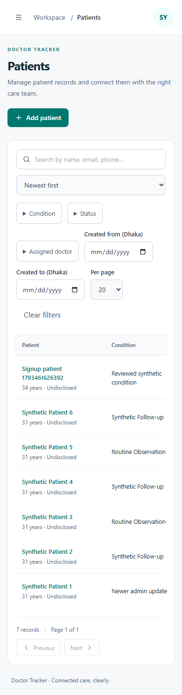
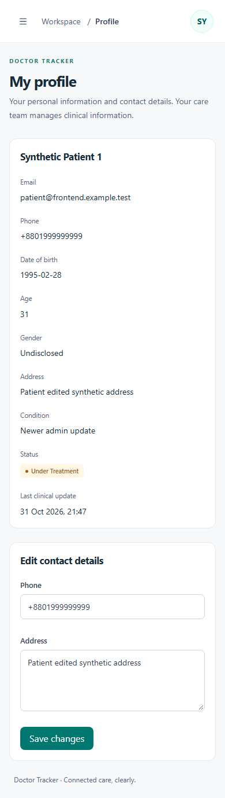

# Doctor Tracker Frontend

## Description

Doctor Tracker brings doctors, and patients together in one care management portal, making it easy to coordinate patient assignments, keep clinical records up to date, and give patients a clear view of their care. With dedicated spaces for each role and private notes for doctors, it helps care teams stay organized and patients stay informed.

## Setup guide

Requires **Node.js 24** and **npm 11**. Commands use PowerShell (`cp` replaces `Copy-Item` in Bash).

1. Complete the [backend setup](../doctor-tracker-backend/README.md#setup-guide) and leave it running on port 4000.
2. Install dependencies and copy [.env.example](.env.example):

   ```powershell
   cd doctor-tracker-frontend
   npm ci
   Copy-Item .env.example .env.local
   ```

3. Set `BACKEND_ORIGIN=http://localhost:4000` in `.env.local`, without a path or trailing slash. The backend's `FRONTEND_ORIGIN` must be `http://localhost:3000`.
4. Run `npm run dev` and open [localhost:3000](http://localhost:3000). Sign in with your provisioned administrator; doctor/patient registrations require approval.

For production: `npm run build`, then `npm start`. Set `BACKEND_ORIGIN` before building and at runtime. Keep database credentials and session secrets in the backend.

## System architecture



Server layouts verify sessions and roles through `/auth/me`. Client components use a typed API client and TanStack Query. Mutations include CSRF tokens; successful writes refresh affected queries. Revision conflicts preserve drafts, and logout clears private cached data. Express owns authorization and persistence.

## Technical decisions

### 1. Same-origin proxy and cookie sessions

Next.js proxies API calls so server layouts and browser components share an HttpOnly session cookie. Compared with browser-managed bearer tokens, this avoids client token storage and refresh logic. The tradeoff is an extra proxy hop plus CSRF, origin and HTTPS configuration.

### 2. Generated OpenAPI types

The committed API contract generates request/response types instead of maintaining handwritten interfaces. Version and checksum checks expose contract drift without importing backend code or requiring a live API. Updates require reviewed regeneration; types do not replace runtime validation or integration tests.

## Checks

```powershell
npm run api:check
npm run lint
npm run format:check
npm run typecheck
npm test
npm run build
```

Browser tests: `npx playwright install chromium`, then `npm run test:e2e`. The runner uses the sibling backend and a disposable MongoDB replica set on ports 3100/4100.

After updating the contract and provenance, regenerate types with `npm run api:generate`.

See [detailed architecture](docs/architecture.md) and [deployment](../doctor-tracker-backend/deploy/README.md).

Google Sign-In setup and callback requirements are documented in [authentication](../docs/authentication.md#google-sign-in). Credentials belong only in the backend environment; no frontend Google secret is required.

## Visual Evidence of Screenshots

### Desktop dashboard

The administrator overview brings care team totals, patient status, and trends into one workspace.



### Mobile views

Manage patient records and view personal care information on smaller screens. Select a screenshot to see it at full size.

|                                                                               Patient management                                                                               |                                                                                          Patient profile                                                                                           |
| :----------------------------------------------------------------------------------------------------------------------------------------------------------------------------: | :------------------------------------------------------------------------------------------------------------------------------------------------------------------------------------------------: |
| [](docs/screenshots/patients-mobile.png) | [](docs/screenshots/patient-profile-mobile.png) |

